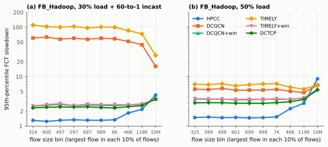

# hpcc-repro

從零寫的封包層級（packet-level）資料中心網路模擬器，用來重現論文
**〈HPCC: High Precision Congestion Control〉**（Yuliang Li 等人，ACM SIGCOMM 2019）的實驗結果。
這個專案的目的是學習頂尖研究的結果要怎麼被驗證：演算法和實驗設計都來自論文，這裡沒有提出任何新方法。

HPCC 讓封包經過的每一台交換器，把自己「目前排隊多長、已經送出多少位元組、連線速度多少」寫進封包
（In-band Network Telemetry，INT）；接收端把這些資訊放進 ACK 帶回去，傳送端就能依照「最忙那條線路」
的確切負載來設定自己的送出量。論文宣稱這樣做可以讓佇列幾乎是零、短流量（short flow）的尾端延遲大幅下降，
而且不會像 DCQCN、TIMELY 那樣觸發大規模的 PFC 暫停。這個專案用 Rust 重建論文的 320 台主機、100/400 Gbps
FatTree 拓樸與流量（和作者的 ns-3 模擬器沒有共用任何程式碼），逐張圖檢查這些說法。

| 論文的說法 | 論文 | 本專案（`make repro`） |
|---|---|---|
| HPCC 的 95 百分位 RTT，FB_Hadoop 50% 負載（圖 11d） | 19.8 us | **19.8 us**（3 個亂數種子都一樣） |
| HPCC 與 DCTCP 尾端 RTT 比較 | 低「兩倍以上」 | 低 1.85 倍（36.7 us 對 19.8 us） |
| 30% 負載 + incast 時的 PFC 暫停（圖 11b） | 只有 DCQCN、TIMELY 會有 | 只有 DCQCN（13 175 個暫停訊框）與 TIMELY（23 350）；HPCC、DCTCP、DCQCN+win、TIMELY+win 都是 0 |
| 120 KB 以下流量的 95 百分位減速倍數，30% + incast（圖 11a） | HPCC 最低 | HPCC 1.65、DCTCP 2.44、DCQCN+win 2.67、TIMELY+win 2.71、DCQCN 56.6、TIMELY 95.5 |
| 3 KB 以下流量的 99 百分位減速倍數，WebSearch 50%（圖 10） | HPCC 2.70 對 DCQCN 53.9（實體測試床） | HPCC 1.89 對 DCQCN 11.1（模擬的 FatTree） |
| 50% 負載時長流量用 HPCC 比較慢（§5.3） | 約 1.24 倍（理論估計） | 中位數 1.07 倍、95 百分位 1.52 倍（maxStage = 0 時 1.15 倍） |
| W_AI <= 150 B 時 95 百分位佇列在 4 KB 內；300 B 時 13 KB（圖 14） | 4 KB / 13 KB | 4.4 KB / 12.0 KB |
| 每個 ACK 都反應會過度反應、每個 RTT 反應一次太慢，HPCC 又快又穩（圖 13） | 定性描述 | per-ACK 的吞吐量掉到 0 Gbps；per-RTT 的佇列持續到 190 us，HPCC 108 us 就清空 |

完整討論：**[docs/report.md](docs/report.md)**（論文的主張、實驗設定、逐圖比較、差異原因、效度威脅）。
所有圖表和論文對應圖的說明並排：**[docs/results.html](docs/results.html)**（直接用瀏覽器開檔即可，沒有 JavaScript、
沒有外部資源）。給初學者的中文導讀：**[docs/導讀.zh-TW.md](docs/導讀.zh-TW.md)**。



## 示範

在縮小版（32 台主機）FatTree 上跑 FB_Hadoop 30% 負載加上 60 對 1 incast，以下是真實輸出：

```
$ ./target/release/hpcc-sim fct --cc hpcc --workload fbhadoop --load 0.3 --incast --small --out results/demo-hpcc
experiment=fct topology=fattree-small-32 workload=FB_Hadoop load=0.3 incast=true warmup_ps=1000000000 measure_ps=5000000000 cc=hpcc seed=1 pfc=true wai=default max_stage=default: 9025 flows done, sim 9.051 ms, 20196897 events in 1.0 s, drops 0, pause frames 0, host pause 0.0 us, switch pause 0.0 us, rtt p95 22.4 us
$ ./target/release/hpcc-sim fct --cc dcqcn --workload fbhadoop --load 0.3 --incast --small --out results/demo-dcqcn
experiment=fct topology=fattree-small-32 workload=FB_Hadoop load=0.3 incast=true warmup_ps=1000000000 measure_ps=5000000000 cc=dcqcn seed=1 pfc=true wai=default max_stage=default: 8405 flows done, sim 8.457 ms, 19131687 events in 1.1 s, drops 0, pause frames 16, host pause 110.1 us, switch pause 59.6 us, rtt p95 490.7 us
```

每次執行會在 `--out` 資料夾寫出 `fct.csv`（每個流量的完成時間與精確的理想完成時間）、`summary.json`、
佇列與 RTT 分布。在 Mac 上可以直接雙擊 **`跑跑看.command`**：它會編譯、執行 `make quick` 並打開結果網頁。

## 運作方式

```
 主機（RDMA 網卡模型）                    交換器（共享緩衝區、PFC、ECN、INT、ECMP）
 +--------------------------+  資料   +-------------------------------------------------+
 | 每個流量各自控速 + 視窗  |-------->| 入口計量 -> 往上游送 PFC 暫停/恢復              |
 | 壅塞控制：HPCC / DCQCN / |         | 出口佇列 -> 出隊時：ECN 標記、寫入 INT          |
 |   DCTCP / TIMELY         |<--------|   每一跳 {時間, 已送位元組, 佇列長度, 頻寬}     |
 | 接收端：回 ACK + 複製 INT|  ACK    +-------------------------------------------------+
 +--------------------------+
          全部由一個事件佇列驅動，依（皮秒時間, 排程順序）排序
```

* **事件核心**（`src/event.rs`、`src/time.rs`）：時間用整數皮秒，100 Gbps 剛好是每位元組 80 ps；同一時間的事件
  照排程順序執行，所以每次執行結果逐位元相同。
* **網路**（`src/sim.rs`、`src/mmu.rs`、`src/routing.rs`）：store-and-forward 連線、每個埠兩個嚴格優先權佇列
  （控制、資料）、動態門檻共享緩衝區與 PFC headroom、出隊時做 RED ECN 與 INT、每個流量固定一條 ECMP 路徑。
* **演算法**（`src/cc/`）：逐行實作 HPCC 的 Algorithm 1（加上圖 13 的 per-ACK、per-RTT 變形）、DCQCN 與
  DCQCN+win、DCTCP、TIMELY 與 TIMELY+win，每個都是可單獨測試的狀態機。
* **實驗**（`src/experiments.rs`、`analysis/`）：論文的 FatTree、WebSearch/FB_Hadoop 流量、incast、微基準測試；
  用 matplotlib 畫圖。

參數照論文設定（eta = 95%、maxStage = 5、W_AI = 80 B、T = 13 us、每台交換器 32 MB 緩衝區、DCQCN/DCTCP 的 ECN
門檻隨連線速度調整、PFC 在約 11% 空閒緩衝區時觸發、INT 額外 42 B）。論文沒寫的值取自作者公開的腳本，
每一項都列在 [docs/DESIGN.md](docs/DESIGN.md)。

## 結果

圖 9、10、11、13、14 都以論文的完整規模重現（圖 9 和 10 在論文裡是實體測試床，這裡用模擬）。
[docs/report.md](docs/report.md) 的結論摘要：

* **吻合**：HPCC 對短流量的優勢（圖 10、11）、只有沒有視窗的方法會觸發 PFC（圖 11b）、HPCC 的 95 百分位 RTT
  （19.8 us）、反應方式的比較（圖 13）、W_AI 門檻（圖 14）、長短流恢復、incast 反應與公平性（圖 9）。
* **部分吻合**：長流量的代價（95 百分位比論文估計大，除非 maxStage = 0）；圖 10 的 DCQCN 尾端與圖 9e 的
  DCQCN 小流量延遲沒有測試床那麼極端；DCTCP 的尾端 RTT 是 HPCC 的 1.85 倍而不是兩倍以上。
* **沒有重現**：圖 12（沒有實作 IRN）、圖 1-3 與圖 6。

### 和作者模擬器的交叉驗證

作者的 ns-3 模擬器（[alibaba-edu/High-Precision-Congestion-Control](https://github.com/alibaba-edu/High-Precision-Congestion-Control)）
用的 waf 1.7 需要 Python 2。`tools/build_official_ns3.py` 直接用 clang++ 編譯它需要的十個 ns-3 模組（4 核心
20 秒；作者的程式碼只複製到暫存資料夾，從不加入本專案）。接著讓兩個模擬器跑**同一個** 32 台主機拓樸、
**同一批** 23 175 個 FB_Hadoop 50% 負載的流量（`hpcc-sim fct ... --export-ns3 DIR`，再用
`tools/crosscheck_ns3.py` 比較），HPCC 用論文參數（maxStage 5、W_AI 約 80 B），DCQCN 用廠商參數。
以下是在 [1 ms, 4 ms) 開始的 4 944 個流量，兩邊都用同一個精確理想完成時間計算減速倍數：

| | 中位數：本專案 / 作者 | 95 百分位：本專案 / 作者 | 99 百分位：本專案 / 作者 |
|---|---|---|---|
| HPCC，全部流量 | 1.05 / 1.12 | 3.50 / 3.64 | 7.05 / 7.55 |
| HPCC，最小的流量區間 | 1.03 / 1.03 | 1.88 / 2.20 | 3.21 / 3.29 |
| HPCC，最大的流量區間 | 2.74 / 2.81 | 8.91 / 10.17 | 18.45 / 17.74 |
| DCQCN，全部流量 | 1.13 / 1.66 | 7.34 / 10.74 | 14.45 / 20.14 |
| DCQCN，最小的流量區間 | 1.03 / 1.24 | 8.69 / 14.74 | 20.80 / 27.85 |

HPCC 非常接近（中位數差 1-7%，尾端差約 15% 以內）。DCQCN 則是本專案比較樂觀：作者的模擬器裡短流量的中位數
較高、尾端高 1.3-1.8 倍，表示他們的 DCQCN 維持了更多排隊。在限定時間內沒有找到確切原因，可能來自網卡的
封包排程與控速更新方式，或交換器控制佇列的排程方式。用作者的數字，「HPCC 優於 DCQCN」的結論只會更明顯，
但本專案 DCQCN 的絕對數值要帶著這個差距來看。

### 執行時間

`make repro` 跑 39 次模擬（圖 10、11 用論文的 320 台主機 FatTree），在 Apple M5（10 核心，量測時有其他工作同時
在跑）上用 4 個平行工作花 **8.1 分鐘**。單次完整規模模擬 30-160 秒；模擬器單核心每秒處理約 1300 萬個事件
（`make bench`），每次完整規模模擬約用 130 MB 記憶體。`make quick`（32 台主機、短時間窗）約 40 秒。

## 驗證

模擬器本身和它執行的演算法分開測試（`cargo test --release`，共 71 個測試）：

* **時間**：單一封包的延遲等於手算值；四種拓樸上、各種奇怪大小的單一流量，完成時間和當作減速倍數分母的
  理論值完全相同（精確到皮秒）。
* **緩衝區與 PFC**：60 萬次隨機緩衝區操作，每一步都檢查不變量；剛好到門檻就暫停、低於門檻 3 KB 才恢復；
  開 PFC 時從不掉封包（包含 PFC 經過三台交換器往回傳）；關掉 PFC 時會掉封包，go-back-N 能補回。
* **位元組守恆**（送出 = 收到 + 丟棄 + 還在網路中）：12 次隨機模擬中的許多時間點都檢查。
* **ECMP**：結果固定、分散平均、用到 5-tuple 的每個欄位。**事件佇列**：同時事件先進先出、隨機比對參考模型。
* **演算法**：每個壅塞控制都有單元測試；在網路上，單一長流量能跑滿線速（HPCC 剛好是 eta 扣掉 INT 開銷）、
  六種方法的四個流量都會收斂到公平分享、DCTCP 把佇列維持在 K 附近、加上視窗能讓 DCQCN 不觸發 PFC、HPCC 看得到
  五台交換器外的瓶頸。
* **決定性**：同一個種子同一個結果；在 macOS/arm64 記錄的 golden digest 會在 CI 的 Linux/x86-64 上檢查。
* **突變測試**：16 個故意放進去的一行錯誤（例如 HPCC 讀錯跳的佇列長度、PFC 差一個位元組、ECN 門檻沒有隨速度
  調整），每一個都必須讓測試失敗：[docs/mutants.md](docs/mutants.md)。

## 限制

* 沒有模擬網卡/PCIe 處理延遲、ACK 合併、PFC 暫停時間單位（改用明確的暫停/恢復訊框）、多個無損類別、
  線路故障、IRN、HPCC-PINT。
* ACK 一律走高優先權佇列（作者的程式碼裡 HPCC 和 DCTCP 的 ACK 走資料佇列）。
* 量測時間窗是 5-10 ms 的到達流量（FB_Hadoop 5 萬到 8.3 萬個流量，WebSearch 7 千到 1.2 萬個），所以 WebSearch
  每個大小區間的 99 百分位只靠 7 到 12 個流量決定。
* 論文對 PFC 暫停比例和佇列取樣範圍沒有精確定義，本專案使用的定義寫在結果網頁上。
* DCQCN 的數值和作者的模擬器有差距（見上面的交叉驗證）。

## 相關研究

* Li 等人，*HPCC: High Precision Congestion Control*，SIGCOMM 2019，與作者的 ns-3 模擬器
  [alibaba-edu/High-Precision-Congestion-Control](https://github.com/alibaba-edu/High-Precision-Congestion-Control)
  （以 ns-3.17 為基礎，也包含 Ben Basat 等人 *PINT*（SIGCOMM 2020）的 HPCC-PINT）。這裡用的流量大小分布就是該
  專案 `traffic_gen/` 裡的表格。
* [ns-3](https://www.nsnam.org/)（作者使用的模擬器框架），以及它的前身、DCQCN 作者的 RDMA 擴充
  [ns3-rdma](https://github.com/bobzhuyb/ns3-rdma)。
* [inet-tub/ns3-datacenter](https://github.com/inet-tub/ns3-datacenter)（PowerTCP，NSDI 2022 等後續研究），
  延伸自 ns3-rdma 與 HPCC 的程式碼。
* DCQCN：Zhu 等人，SIGCOMM 2015。DCTCP：Alizadeh 等人，SIGCOMM 2010。TIMELY：Mittal 等人，SIGCOMM 2015。
  流量：DCTCP 論文（WebSearch）與 Roy 等人 *Inside the Social Network's (Datacenter) Network*，SIGCOMM 2015
  （FB_Hadoop）。

我找到的其他 HPCC 模擬器都是作者 ns-3 程式碼的分支或延伸。就我所知，這是一個獨立重新實作的版本而不是衍生
版本；它是用來學習的重現研究，除了檢驗論文的結果之外不做其他主張。

## 建置與測試

需要：Rust stable（`cargo`）、Python 3（實驗執行腳本只用標準函式庫；畫圖用 matplotlib，Makefile 會自動裝進
`.venv`）、`make`。

```
make build      # 編譯 target/release/hpcc-sim
make test       # 71 個測試：單元、網路模型驗證、壅塞控制行為、golden digest
make lint       # rustfmt、clippy -D warnings、Python 語法
make quick      # 32 台主機實驗 + 圖 + results/quick/index.html（約 40 秒）
make repro      # 論文規模完整實驗 + docs/figures + docs/results.html（約 8 分鐘，4 個平行工作）
make bench      # 一次固定的完整規模模擬，印出每秒事件數
make mutants    # 突變測試，重寫 docs/mutants.md（約 7 分鐘）
```

Makefile 只用相對路徑，所以專案放在名稱有空白或中文的資料夾也能用。`JOBS=n make repro` 可以改平行數。

## 授權

MIT，見 [LICENSE](LICENSE)。
