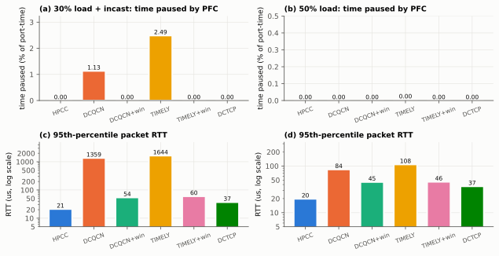
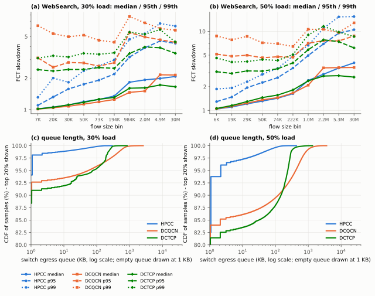
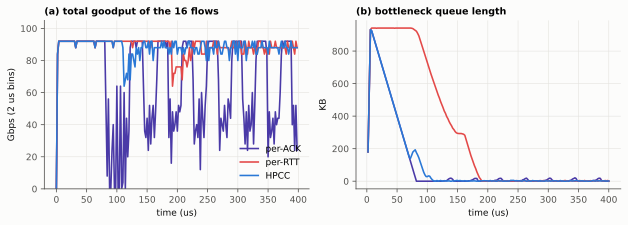
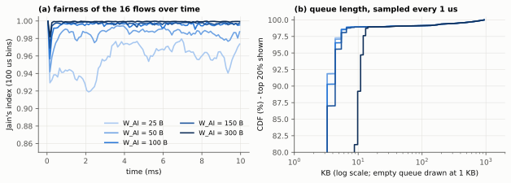

# Reproducing "HPCC: High Precision Congestion Control" in an independent simulator

*A reproduction report in the style of Stanford CS244 / MIT 6.829 projects. This is an independent re-implementation
for study; it proposes nothing new.*

**Paper.** Yuliang Li, Rui Miao, Hongqiang Harry Liu, Yan Zhuang, Fei Feng, Lingbo Tang, Zheng Cao, Ming Zhang,
Frank Kelly, Mohammad Alizadeh, Minlan Yu. "HPCC: High Precision Congestion Control." ACM SIGCOMM 2019. Part of
Yuliang Li's Harvard PhD dissertation "Hardware-Software Codesign for High-Performance Cloud Networks".

**Artifacts here.** About 6 100 lines of Rust written from scratch (simulator, algorithms and tests in `src/` and
`tests/`), the experiment matrix and figure scripts (`analysis/`), the generated figures (`docs/figures/`), all
numbers (`docs/results-numbers.json`) and a results page (`docs/results.html`). Every number in this report comes
from `make repro` on an Apple M5 (shared with other jobs), seed 1 unless stated.

## 1. What the paper claims

HPCC replaces the coarse congestion signals of RDMA congestion control (ECN marks for DCQCN and DCTCP, RTT for
TIMELY) with precise per-hop load information carried by In-band Network Telemetry (INT): each switch stamps the
egress port's queue length, cumulative transmitted bytes, timestamp and link speed into the packet, the receiver
echoes the stack in the ACK, and the sender computes the normalised in-flight bytes of the most loaded link,
`U = qlen/(B*T) + txRate/B`. It then sets its window to `W = W^c / (U/eta) + W_AI` (multiplicative, aiming at
eta = 95% utilisation) and paces at `W/T`, reacting on every ACK but relative to a reference window `W^c` that
changes only once per RTT. The claims tested here:

1. **C1 - short flows.** HPCC gives much lower tail (95th/99th-percentile) FCT slowdown for short flows than DCQCN,
   TIMELY, their windowed variants and DCTCP, with similar medians (Figures 10 and 11).
2. **C2 - latency and queues.** HPCC keeps queues near zero: 95th-percentile network RTT of 19.8 us at 50% load on a
   12 us base RTT, more than 2x lower than DCTCP (Figure 11d); MB-scale queue tails for DCQCN versus tens of KB for
   HPCC (Figure 10).
3. **C3 - stability.** Large PFC pauses appear only with DCQCN and TIMELY; giving them a window like HPCC's reduces
   pauses to almost zero (Figure 11b). Controlling in-flight bytes is the key.
4. **C4 - long flows pay a price.** Long flows are slower with HPCC because of the 5% headroom and INT bytes; the
   paper estimates 1.24x at 50% load (§5.3).
5. **C5 - fast reaction without overreaction.** Per-ACK reaction overreacts, per-RTT reaction is slow, HPCC's
   reference-window scheme is both fast and stable (Figure 13).
6. **C6 - choosing W_AI.** `W_AI <= W_init (1 - eta) / N` keeps queues small for N flows; above it queues grow
   (Figure 14: within 4 KB at the 95th percentile for W_AI <= 150 B with 16 flows, 13 KB at 300 B).
7. **C7 - micro-benchmarks.** Faster rate recovery, faster incast reaction, near-base-RTT latency for mice, fairness
   (Figure 9, testbed).

## 2. Setup

### 2.1 Simulator

Written for this project; no code is shared with the authors' ns-3 simulator. Model summary (details and the full
table of modelling choices in [DESIGN.md](DESIGN.md)):

* Store-and-forward links with exact picosecond serialization and 1 us propagation; output-queued switches with a
  32 MB shared buffer, dynamic PFC thresholds (alpha = 1/8 at NIC speed, i.e. pause at about 11% of the free buffer,
  as §5.1 states) and per-port headroom; RED-style ECN at dequeue; INT stamped at dequeue; per-flow ECMP.
* NICs pace each flow at its CC rate, enforce its window, serve flows round-robin, ACK every packet, obey PFC.
* Data packets carry 1000 B payload + 48 B headers (+42 B INT for HPCC, the paper's worst case); ACKs are 60 B
  (+42 B INT for HPCC). In switches ACKs wait in the same queue as data, which is what the authors' simulator does
  (§6); a high-priority ACK class is run as a sensitivity case.
* Senders: HPCC (Algorithm 1; eta = 0.95, maxStage = 5, W_AI = 80 B, T = 13 us), DCQCN with the vendor timers the
  paper names (Ti = 300 us, Td = 4 us; other constants from the authors' `run.py`), DCQCN+win, DCTCP (g = 1/16,
  K = 30 KB x Bw/10G, no slow start), TIMELY and TIMELY+win (parameters of the TIMELY paper).

### 2.2 Topology and traffic

* **FatTree as in §5.1, at full scale**: 320 hosts with 100 Gbps NICs, 20 ToR, 20 Agg and 16 core switches,
  400 Gbps fabric links, 1 us per link (12 us maximum base RTT), 32 MB buffer per switch. Nothing was scaled down
  for Figures 10 and 11. (`make quick` runs a 32-host tree with the same link speeds, delays, path lengths and
  oversubscription for a fast smoke test.)
* **Workloads**: FB_Hadoop and WebSearch flow-size CDFs (as tabulated in the HPCC artifact), Poisson arrivals per
  host at 30% or 50% of the NIC rate, uniform random destinations; for "30% + incast", 60 random senders x 500 KB
  to one random receiver, at 2% of total host capacity.
* **Measurement**: flows that start in [1 ms, 6 ms) (FB_Hadoop) or [1 ms, 11 ms) (WebSearch) are measured; arrivals
  continue to the end so that measured flows never finish in an emptying network; the run ends when all measured
  flows complete (hard stop 26 / 36 ms). Measured flows: 50 421 (FB 30%+incast), 82 662 (FB 50%), 6 930 and
  11 556 (WebSearch 30% / 50%). Flows still running at the hard stop are counted with their elapsed time as a lower
  bound on their FCT: at most 8 per run, except TIMELY with incast (19 of 50 421, held up behind PFC pauses).
* **Metrics**: FCT slowdown = FCT / FCT of the same flow alone in the network at line rate (computed exactly, see
  DESIGN.md), clamped at 1. Flows are put into 10 equal-count size bins, as in the authors' analysis script; the
  resulting bin edges reproduce the paper's x-axis labels (324, 400, 500, 600, 700, 1K, 7K, 46K, 120K, 10M for
  FB_Hadoop). Network latency = per-packet RTT measured at the sender. PFC: share of port-time paused, over all host
  and switch ports, after warm-up.

### 2.3 Cost

The full set (41 runs plus figures) takes about 7.8 minutes of wall time with 4 parallel jobs (`make repro`); a single
full-scale FatTree run takes 20-150 s at about 13 million events per second. Two complete runs of the same code
produce bit-identical numbers and figures, and outputs are byte-identical between arm64 and x86-64 builds.

## 3. Results, figure by figure

Verdicts: **matches** (same qualitative result and comparable numbers), **partly** (same direction, notable numeric
difference), **differs**.

### Figure 11 - FB_Hadoop on the FatTree (a simulation in the paper too)

95th-percentile slowdown of all flows of at most 120 KB:

| | HPCC | DCTCP | DCQCN+win | TIMELY+win | DCQCN | TIMELY |
|---|---|---|---|---|---|---|
| 30% load + incast | **1.85** | 3.01 | 3.68 | 3.77 | 102.3 | 134.8 |
| 50% load | **2.10** | 3.58 | 4.24 | 4.14 | 7.77 | 9.43 |

* **C1 matches.** HPCC has the lowest 95th-percentile slowdown in every bin up to 120 KB in both cases; for flows up
  to 7 KB it stays between 1.6 and 1.8. DCQCN and TIMELY are far worse with incast (slowdowns of 70-150), the
  windowed variants and DCTCP are in between. The paper's ordering is the same.
* **C4 partly.** In the largest-flow bin at 50% load HPCC's median slowdown is 2.37, the same as DCQCN, DCQCN+win and
  DCTCP (0.99x their mean), but its 95th percentile is 9.3 versus 5.5-8.3 for the others (1.44x their mean). The
  paper's 1.24x is an analytical estimate (residual capacity 44.6% vs 36.1%). The 95th-percentile gap here is larger
  than that estimate, and a sensitivity run points at the cause: with maxStage = 0 (the default in the authors'
  public `run.py`) instead of the paper's stated 5, the largest-bin 95th percentile drops from 9.3 to 7.0 (1.08x),
  while short flows get slightly worse (1.76 -> 1.88 in the smallest bin). With maxStage = 5 a long flow that starts
  on a busy link waits six RTTs between multiplicative increases and creeps up by W_AI = 80 B per RTT meanwhile, so
  it reclaims bandwidth slowly. Which value produced the paper's Figure 11 cannot be told from the paper.

| | HPCC | DCTCP | DCQCN+win | TIMELY+win | DCQCN | TIMELY |
|---|---|---|---|---|---|---|
| PFC pause frames, 30% + incast | 0 | 0 | 0 | 20 | 30 132 | 38 280 |
| port-time paused, 30% + incast | 0 | 0 | 0 | 0.001% | 4.1% | 4.6% |
| RTT p95, 30% + incast (us) | **23.1** | 42.5 | 94.4 | 474 | 2 164 | 2 265 |
| RTT p95, 50% (us) | **21.6** | 41.7 | 51.1 | 48.2 | 115.9 | 138.4 |

* **C3 matches.** Large PFC pauses appear only for the two schemes without a window (30 132 and 38 280 pause
  frames); adding the window reduces them to almost zero (0 for DCQCN+win, 20 for TIMELY+win, the paper's "almost
  zero"); DCTCP and HPCC never pause. With incast, DCQCN and TIMELY tail latencies are in the millisecond range, as
  in the paper's Figure 11b. The paused fraction (4-5% of port-time) is not comparable with the paper's bars: the
  paper does not say over which ports or which period it is computed.
* **C2 matches, with a 9% difference in the one directly comparable number.** HPCC's 95th-percentile RTT at 50% load
  is 21.6 us against the paper's 19.8 us. The RTT here includes the ACK's wait in the reverse path's data queue (the
  authors' simulator queues ACKs that way, §6); with ACKs in a high-priority class the same run gives exactly
  19.8 us, so the paper's metric may not include the reverse queue - the paper does not define it. DCTCP's tail RTT
  is 41.7 us, 1.93x HPCC's; the paper says "more than 2 times".
* Seed variation: with seeds 2 and 3 HPCC's smallest-bin 95th percentile is 1.81 and 1.85 (seed 1: 1.76), DCQCN's
  8.00 and 8.77 (seed 1: 8.16); HPCC's RTT p95 is 21.6 us for all three seeds. No conclusion depends on the seed.
* ACK class sensitivity: with ACKs in a high-priority class (this simulator's original model) DCQCN's smallest-bin
  95th percentile at 50% load is 5.58 instead of 8.16 and HPCC's 1.49 instead of 1.76; every qualitative result
  holds either way.

### Figure 10 - WebSearch (testbed in the paper, simulation here)

| | paper (testbed, 25G) | here (simulated FatTree, 100G) |
|---|---|---|
| 99th-pct slowdown, flows < 3 KB, 30% load | HPCC 2.38, DCQCN 11.2 | HPCC 1.44, DCQCN 7.72 (DCTCP 4.40) |
| 99th-pct slowdown, flows < 3 KB, 50% load | HPCC 2.70, DCQCN 53.9 | HPCC 1.92, DCQCN 15.45 (DCTCP 5.02) |
| median queue | 0 for both | 0 for all three |
| 95th / 99th-pct queue, 50% load | HPCC 19.7 / 22.9 KB; DCQCN 1.1 / 2.1 MB | HPCC 2.3 / 56.3 KB; DCQCN 432 / 987 KB |

* **C1 matches; C2 partly.** The tails of short flows are far better with HPCC (5.4x at 30% and 8.0x at 50% load for
  flows under 3 KB). For flows up to about 200 KB the medians are the same at 30% load (within 1% per bin), but at
  50% load DCQCN's are 10-22% higher than HPCC's; for the largest flows HPCC's medians are higher (C4). Queue tails are
  near zero for HPCC and hundreds of KB to MB for DCQCN.
* **Differences.** The DCQCN tail for tiny flows (15.5 at 50%) is less extreme than the testbed's 53.9, and
  HPCC's 99th-percentile queue (56 KB) is above the testbed's 22.9 KB. Three reasons: (1) this is a simulation of
  the 100G FatTree, not the 25G testbed, so the bandwidth-delay product is about 6x larger (162 KB vs about 28 KB)
  and new flows that start at line rate collide in larger bursts; in BDP units HPCC's queue tail is 0.34 BDP here
  versus about 0.8 BDP on the testbed; (2) the queue percentiles here are over every switch port, most of which are
  idle (only 17.5% of HPCC's samples are non-empty), while the testbed measured loaded ports; (3) the testbed's DCQCN
  ran on real NICs whose implementation details (CNP generation, byte counters) are not modelled.
* **A difference the paper does not show.** For the largest WebSearch flows HPCC's tail is worse than DCQCN's here
  (95th percentile 9.7-10.7 vs 7.4-9.1 at 50% load) - the same long-flow effect as C4.

### Figure 13 - per-ACK vs per-RTT vs HPCC

16-to-1 incast through one 100 Gbps switch, 1 us links, T = 4.5 us.

| | queue below 10 KB from | goodput 50-400 us | lowest 2-us goodput after 50 us |
|---|---|---|---|
| per-ACK | 82 us | 63.1 Gbps | 0 Gbps |
| per-RTT | 190 us | 88.5 Gbps | 64 Gbps |
| HPCC | 108 us | 87.9 Gbps | 64 Gbps |

**C5 matches**, including the shapes: per-ACK empties the 932 KB queue fastest but then collapses to zero
throughput and oscillates; per-RTT keeps the long queue almost twice as long; HPCC drains it nearly as fast as
per-ACK without losing throughput (87.9 Gbps of goodput is about 95% of the wire after header and INT bytes).

### Figure 14 - choosing W_AI

| W_AI | 25 B | 50 B | 100 B | 150 B | 300 B |
|---|---|---|---|---|---|
| 95th-pct queue (1 us samples, 10 ms) | 4.4 KB | 4.4 KB | 4.4 KB | 4.4 KB | 12.0 KB |
| Jain's index, first ms | 0.952 | 0.983 | 0.995 | 0.999 | 1.000 |

**C6 matches**, almost numerically: the paper reports "within 4 KB" for W_AI up to 150 B and 13 KB for 300 B
(4.4 KB is four packets of 1090 B). A larger W_AI converges to fairness faster, as the paper says.

### Figure 9 - testbed micro-benchmarks, re-run in simulation

One 25 Gbps switch with 1 us links (base RTT about 4.9 us vs 5.4 us on the testbed); fair-share steps of 5 ms
instead of 1 s.

* *Long-short* ([figure](figures/fig9_longshort.svg)) - **matches**: HPCC's long flow is back at 95% of its rate
  24 us after the short flow leaves; DCQCN's has not recovered by the end of the run and averages 52% of its earlier
  rate over the next millisecond (paper: "cannot recover to line rate even after 2 ms").
* *Incast* ([figure](figures/fig9_incast.svg)) - **matches**: peak buffer 89 KB for HPCC, 692 KB for DCQCN (paper:
  DCQCN up to 550 KB).
* *Elephant-mice* ([figure](figures/fig9_mice.svg)) - **partly**: 1 KB mice complete in 4.98 us (median) with
  HPCC, essentially the base RTT, and the queue is empty in the median, as in the paper. DCQCN's mice median is 23 us
  (99th percentile 61 us) rather than "consistently higher than 35 us": in this model DCQCN's queue saw-tooths
  between 0 and about 180 KB instead of sitting at the 100 KB marking threshold, presumably because the timer-only
  vendor model used here differs from the testbed NIC firmware.
* *Fair share* ([figure](figures/fig9_fairshare.svg)) - **matches**: Jain's index with four flows is 0.994 for
  HPCC and 0.984 for DCQCN.

## 4. What was not reproduced

* **Figure 12** (PFC vs go-back-N vs IRN): IRN is not implemented. Go-back-N exists only so that the simulator stays
  correct when PFC is disabled in tests.
* **Figures 1-3** (production data and DCQCN tuning trade-offs on Alibaba's testbed) and **Figure 6**
  (txRate vs rxRate) were not attempted.
* **The testbed itself**: Figures 9 and 10 are re-run in simulation, which tests the algorithm, not the FPGA/P4
  prototype of §4.
* **HPCC-PINT** and later variants are out of scope.

## 5. Threats to validity

* **Model fidelity.** No NIC processing or PCIe delay, no ACK coalescing, no PFC pause quanta, one lossless class.
  ACKs share the data queue in switches as in the authors' simulator, which their configuration documentation
  suggests was not intended (§6); the alternative is reported as a sensitivity case. INT costs the paper's
  worst-case 42 B on every data packet.
* **Parameters the paper does not state** were taken from the authors' public scripts (DCQCN timers and steps,
  minimum rate, PFC alpha and headroom); other choices would change absolute numbers. maxStage is the one parameter
  where the paper text (5) and the public scripts (0) disagree; both were run.
* **Measurement windows** are 5-10 ms of arrivals (50 000-80 000 flows for FB_Hadoop, 7 000-12 000 for WebSearch).
  The WebSearch bins hold 700-1 200 flows each, so their 99th percentiles rest on 7-12 flows.
* **Definitions**: the paper's pause fraction and queue-sample population are not defined precisely; this report
  states its own.
* **Validation limits**: the simulator is validated against analytic results and invariants (§7), against the
  paper's published numbers, and against the authors' simulator on one 32-host configuration for all four
  algorithms (§6). The full 320-host runs were not repeated in the authors' simulator.

## 6. Cross-check against the authors' simulator

The authors' ns-3.17-based simulator cannot be built with its own waf 1.7 (it needs Python 2, which is not
installed). `tools/build_official_ns3.py` compiles the ten ns-3 modules its `scratch/third.cc` needs directly with
clang++ (20 s on 4 cores) and links it; nothing of their code enters this repository. Both simulators then ran the
same input: the 32-host tree and 23 175 FB_Hadoop flows at 50% load exported by `hpcc-sim fct --export-ns3`, with
configs written by `tools/crosscheck_ns3.py config` (their `run.py` values, plus the paper's maxStage = 5 and
W_AI of about 80 B). Flows starting in [1 ms, 4 ms) (about 4 945 flows) were compared, each scored against the same
exact ideal FCT. My simulator was run with three seeds (seeds change only ECMP hashing and ECN coin flips, the
flows are identical) to measure its own noise.

**First round: DCQCN did not agree.** HPCC matched, but the authors' DCQCN had 1.2-1.9x higher 95th-percentile
slowdowns for short flows. The DCQCN implementations were then diffed mechanism by mechanism (table in
[DESIGN.md](DESIGN.md) §7): timers, alpha, CNP generation, increase stages, rate limits, ECN, PFC, buffer and NIC
scheduling are equivalent, and simple scenarios (2- and 8-sender incasts, probes, elephants with mice) matched. On a
16-host star with FB_Hadoop traffic the gap reappeared *although the switch queues were the same* (time-averaged
queue lengths within 1.2% in total), so the extra delay was not in the forward queues. A packet trace of their
simulator then showed ACKs enqueued in the data queue at switches, behind about 1.1 MB of data, even with
`ACK_HIGH_PRIO 1`.

**Root cause.** In `scratch/third.cc`, `ACK_HIGH_PRIO` only sets `RdmaEgressQueue::ack_q_idx` on hosts; the
`SwitchNode` attribute `AckHighPrio` (default 0, read in `SwitchNode::SendToDev`) is never set. Their
`mix/config_doc.txt` describes the knob as "1: prioritize ACK", so this looks like an unwired setting, but it is the
behaviour that produced their results: in their switches ACKs (and the CNP flags they carry) always wait behind
data. That delays DCQCN's feedback and adds the reverse path's queue to every FCT - large for DCQCN, negligible for
HPCC's near-zero queues. This simulator originally gave ACKs a high-priority class. Since the goal is to reproduce
the paper's evaluation, the default now mirrors the authors' behaviour (`sim::AckClass`), and the original model is
kept as a sensitivity option.

**Second round, all four algorithms** (slowdown of all compared flows, median / 95th / 99th percentile; "spread" is
the median relative difference over the 30 per-bin statistics):

| | authors' simulator | this simulator, seeds 1 / 2 / 3 | deviation vs own seed spread |
|---|---|---|---|
| HPCC | 1.12 / 3.64 / 7.55 | 1.14 / 3.69 / 7.36, 1.13 / 3.64 / 7.41, 1.13 / 3.70 / 7.49 | 3.8% vs 3.2% |
| DCQCN | 1.66 / 10.74 / 20.14 | 1.73 / 10.73 / 19.85, 1.71 / 10.62 / 19.04, 1.75 / 10.93 / 20.17 | 4.9% vs 9.0% |
| DCTCP | 1.65 / 5.34 / 8.28 | 1.71 / 5.60 / 8.46, 1.72 / 5.65 / 8.66, 1.72 / 5.57 / 8.62 | 4.1% vs 2.5% |
| TIMELY | 1.66 / 18.93 / 43.33 | 1.64 / 18.29 / 45.68, 1.69 / 16.41 / 33.77, 1.63 / 17.76 / 44.12 | 2.5% vs 13.2% |
| DCQCN, ACKs high-priority (old model) | 1.66 / 10.74 / 20.14 | 1.13 / 7.34 / 14.45 | 31.5% |

All four now agree to within a few percent, roughly the size of my simulator's own seed-to-seed variation. Two
small differences remain and are understood: DCTCP is about 4% slower here (its sender is window-paced here and
rate-based in their code), and their integer-nanosecond clock makes links about 1% faster (a lone 1 MB flow at
100G takes 87.09 us there vs the exact 87.93 us). Their DCQCN timers also change the rate without re-timing the
pending packet; no measurable effect was found.

Making ACKs droppable (with PFC off, used only in tests) exposed two liveness bugs in this simulator's go-back-N
path: duplicates were not re-acknowledged, and a late ACK after a rewind could leave `snd_nxt` behind `snd_una`,
stalling the flow. Both are fixed and covered by a regression test and mutants.

## 7. How the simulator itself was validated

* Event queue: time order, FIFO ties, randomised comparison with a reference model.
* Timing: one packet's end-to-end latency equals the hand-computed value; lone flows of awkward sizes on four
  topologies finish exactly (to the picosecond) at the analytic store-and-forward FCT.
* Buffers and PFC: 30 seeds x 20 000 random MMU operations with invariant checks after each; pause triggers exactly
  at the threshold and resume exactly at threshold minus 3 KB; line-rate incasts never drop with PFC on, PFC
  propagates through three switches, every pause is resumed; with PFC off the same incast drops and go-back-N
  delivers everything.
* Byte conservation: injected = delivered + dropped + in flight, checked at many points of 12 random runs across
  topologies, CCs and PFC on/off.
* ECMP: deterministic, spreads 40 000 flows evenly over 4 uplinks, uses all 5-tuple fields.
* Analytic CC checks: lone long flows reach line rate (HPCC: within a few percent of the
  rate predicted from eta and the INT overhead); four flows
  converge to a fair share for every algorithm; DCTCP holds its queue near K.
* Determinism: identical output for identical seeds; golden digests and a full run's output files are identical on
  arm64 and on x86-64 (Rosetta 2); a test forbids libm calls, fused multiply-adds, hash maps and unstable sorts in the
  simulator sources.
* ACK model: a test checks that ACKs in the data class wait behind data and those in the control class do not; a
  lossy run that drops ACKs must still complete every flow.
* Mutation check: deliberate one-line bugs (HPCC reading the queue length of the wrong hop, PFC off by one byte, ECN
  threshold not scaled, ...) each make the suite fail; see [mutants.md](mutants.md).

## 8. Lessons

1. **Independent implementations are only comparable once the baseline is pinned down.** The slowdown denominator
   ("FCT when the network only has this flow") hides store-and-forward pipeline effects and partial packets; making
   it exact and testing it to the picosecond removed a whole class of doubts.
2. **Unstated parameters matter.** maxStage alone moves HPCC's long-flow tail by 30%. A reproduction should run the
   plausible values rather than pick one silently.
3. **The headline results are robust; the fine print is not.** Every qualitative claim reproduced, under both ACK
   models. The one directly comparable number (19.8 us) is matched exactly or missed by 9% depending on an
   undocumented detail (whether ACKs wait behind data), which the paper's text cannot settle. The discrepancies sit where the paper's setup is
   underspecified (pause fraction, queue population) or where the paper's evaluation used hardware (testbed DCQCN).
4. **Controlling in-flight bytes is the key, not only the signal.** The windowed DCQCN and TIMELY never paused, as the
   paper argues; precise INT feedback is what then removes the remaining standing queue.
5. **A baseline you did not write is the best test, and a gap is a lead, not a nuisance.** Running the authors'
   simulator on exactly the same flows exposed a DCQCN gap that no internal test could have found. Narrowing it
   down (same queues, different FCTs, so look outside the queues) and then reading a packet trace found a setting
   that silently does not reach the switches - and, as a side effect, two real bugs in this simulator's loss
   recovery.
